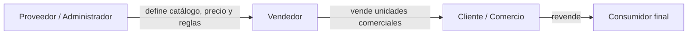
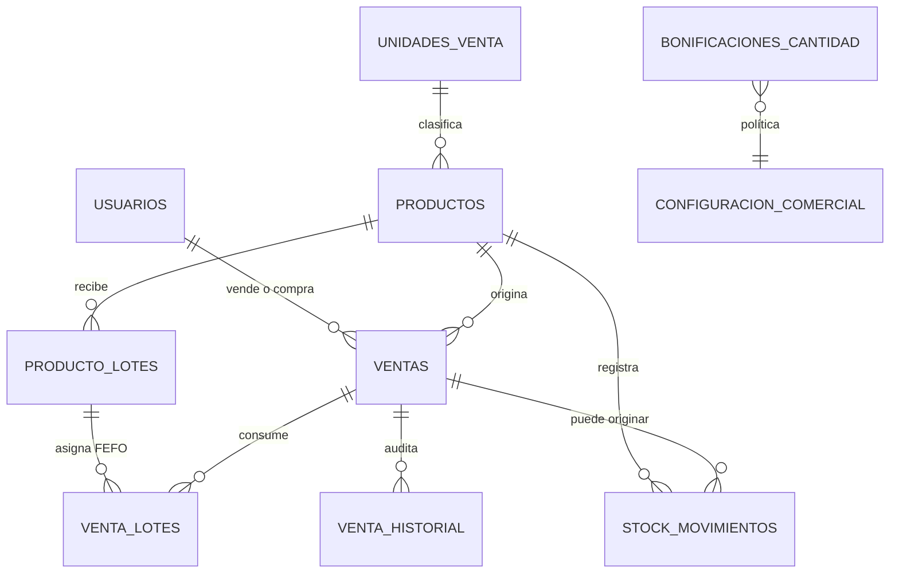

# Modelo comercial de distribución

## Actores



- **Administrador:** representa al proveedor. Gestiona productos, stock, usuarios,
  reglas comerciales, todas las ventas y movimientos.
- **Vendedor:** consulta el catálogo y precio referencial, registra ventas para
  clientes y consulta exclusivamente sus ventas y movimientos relacionados.
- **Cliente:** consulta el catálogo y sus compras. No administra productos,
  stock ni usuarios.

TOTP confirma identidad; el rol continúa saliendo únicamente de MariaDB.

## Producto, unidad y stock

Cada producto tiene exactamente una unidad comercial en esta versión:
`UNIDAD`, `CAJA`, `BOLSA`, `BULTO`, `PACK`, `DOCENA`, `DISPLAY` o `PAQUETE`. El catálogo
está en `unidades_venta`, por lo que puede ampliarse sin modificar un `ENUM`.

`productos.stock` siempre cuenta la presentación comercial elegida. Ejemplo: un
producto configurado como Caja con stock 10 significa **10 cajas**. La relación
estructurada `unidades_por_presentacion` + `unidad_base_codigo` permite informar
y reportar que equivalen a 240 unidades sin cambiar la unidad en la que se
controla la existencia.

La categoría organiza el catálogo y `activo` permite retirar un producto sin
borrar la fila ni romper sus ventas históricas. Los endpoints de catálogo y de
alta de ventas admiten únicamente productos activos.

La presentación no puede cambiarse mientras exista stock, porque reinterpretar
la misma cifra en otra unidad sería ambiguo. Las reposiciones se registran como
lotes mediante la operación de ingreso; editar datos comerciales no altera el
stock.

## Precio de venta

`productos.precio` es el precio referencial vigente para ventas futuras. El
vendedor envía únicamente el porcentaje de margen; PHP obtiene el precio desde
MariaDB y realiza el cálculo definitivo usando centavos enteros y redondeo
comercial a dos decimales:

```text
precio_con_margen = precio_referencial × (1 + margen / 100)
precio_final_unitario = precio_con_margen × (1 - bonificación / 100)
total = precio_final_unitario × cantidad
```

Ejemplo verificado:

```text
10.000,00 + 15% = 11.500,00
11.500,00 - 5% = 10.925,00
10.925,00 × 3 = 32.775,00
```

El margen debe ser no negativo y no superar `configuracion_comercial.margen_maximo`.
El valor inicial es 100%, pero el administrador puede cambiarlo desde el panel;
es una configuración comercial, no una constante aceptada del navegador.

## Bonificaciones configurables

`bonificaciones_cantidad` define rangos no superpuestos mediante cantidad desde,
cantidad hasta opcional y porcentaje. Sin reglas activas la bonificación es 0%.
El backend selecciona la regla activa que contiene la cantidad; nunca acepta una
bonificación enviada por el vendedor.

Al modificar la cantidad de una venta se conservan su precio referencial y
margen originales, se obtiene la regla activa correspondiente a la nueva
cantidad y se recalculan bonificación, precio final y total. La operación queda
en auditoría.

## Snapshot inmutable de la venta

Cada fila de `ventas` conserva:

- `producto_nombre`;
- `precio_referencial_snapshot`;
- `porcentaje_vendedor`;
- `bonificacion_porcentaje`;
- `precio_final_unitario`;
- `unidad_venta_snapshot`;
- `unidad_venta_plural_snapshot`, para mostrar correctamente cantidades sin depender del catálogo vigente;
- `cantidad` y `total`;
- vendedor, cliente, fecha y estado.

Editar después el nombre, precio o unidad del producto no cambia ventas
anteriores. `precio_unitario` se mantiene por compatibilidad y contiene el mismo
valor que `precio_final_unitario` para ventas nuevas.

## Stock y auditoría



`stock_movimientos` responde cuándo, por qué, cuánto y quién cambió el stock.
Tipos:

- `ALTA_INICIAL`: primer lote al crear un producto;
- `INGRESO`: reposición mediante un lote nuevo;
- `AJUSTE`: corrección trazable de inventario;
- `VENTA`: descuento al registrar una venta;
- `MODIFICACION_VENTA`: diferencia causada por un cambio de cantidad;
- `CANCELACION`: devolución idempotente del stock.
- `BAJA`: retiro lógico del producto.
- `VENCIMIENTO`: reserva el tipo para una regularización explícita por caducidad.

Las ventas usan FEFO y no consumen lotes vencidos. La relación `venta_lotes`
permite que una modificación o cancelación restituya el lote exacto. El detalle
completo de EAN, lotes, fechas y alertas está en `PRODUCTOS_EAN_LOTES.md`.

La venta, su auditoría y el movimiento de stock se escriben en una misma
transacción con bloqueo de las filas involucradas.

No se suman cajas, bultos y unidades en un único total. El resumen muestra la
cantidad de productos con disponibilidad y cada fila expresa su stock con la
unidad correspondiente. La migración no inventa movimientos retroactivos: el
historial de stock comienza con cambios realizados desde su instalación.

## Filtros y permisos

El administrador combina fecha desde/hasta, producto, estado y vendedor. El
backend valida que `vendedor_id` corresponda realmente a un usuario con rol
`vendedor` y utiliza sentencias preparadas. Un vendedor no puede usar el filtro
para ver ventas ajenas: el SQL agrega obligatoriamente su propio `usuario_id`.

Todos los endpoints nuevos requieren sesión completa, `mfa_verified`, rol y
CSRF para escrituras. Las cuentas cliente reciben 403 en endpoints de productos,
reglas y ventas que no les corresponden.

## Migración

`migracion_modelo_comercial.sql` agrega las tablas y columnas de manera
incremental. Las ventas existentes fueron conservadas y migradas como:

```text
precio referencial snapshot = precio_unitario anterior
margen = 0%
bonificación = 0%
precio final = precio_unitario anterior
unidad snapshot = Unidad
```

No utiliza `DROP`, `TRUNCATE` ni elimina usuarios, ventas, 2FA o auditorías.

## Pruebas reproducibles

`tests/integracion_comercial.php` prueba tres unidades, fórmulas, snapshots,
edición segura, filtros, aislamiento por vendedor, recálculo, cancelación y
movimientos. Crea datos con prefijo exclusivo y los elimina en `finally`.
