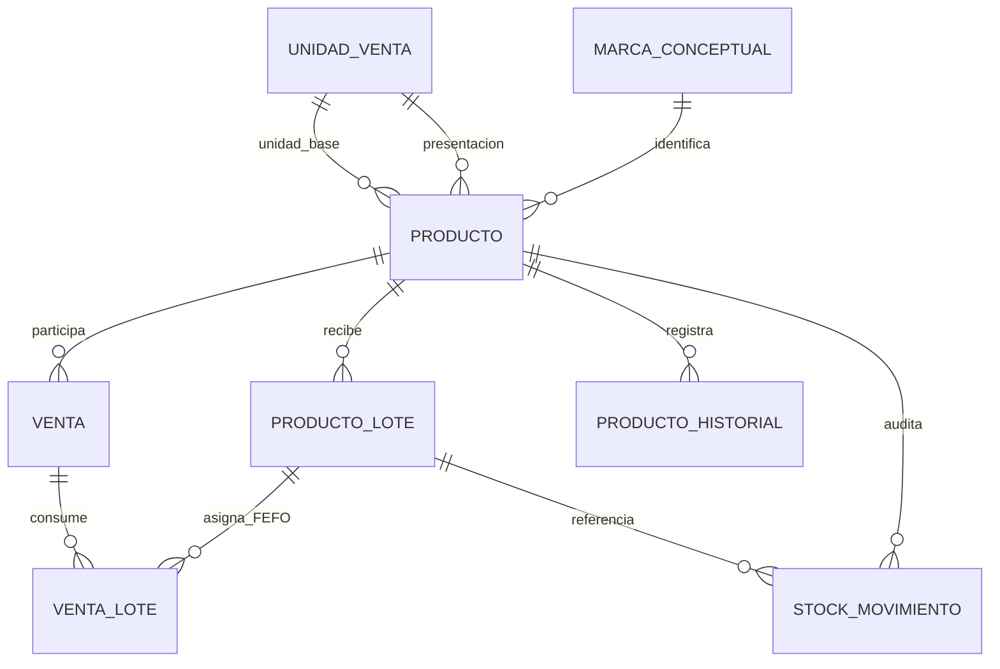

# Productos, EAN-13, lotes y trazabilidad

## Decisiones del modelo

- **Producto**: definición comercial. Conserva la PK interna `id`; `ean13` es un
  identificador comercial opcional para registros heredados y obligatorio para
  altas nuevas.
- **EAN-13**: `CHAR(13)` con índice `UNIQUE`. PHP valida longitud, dígitos y
  checksum; JavaScript solamente mejora la experiencia del escáner.
- **Marca**: columna nullable en `productos`. No se creó una tabla independiente
  porque el sistema no administra un catálogo de marcas.
- **Presentación**: `unidad_venta_codigo`, `unidades_por_presentacion` y
  `unidad_base_codigo` expresan, por ejemplo, `1 Caja = 24 Unidades` sin texto
  ambiguo.
- **Lote**: ingreso físico de un producto. Cada fila de `producto_lotes` tiene
  su propia cantidad, ingreso y vencimiento opcional.
- **Stock**: `productos.stock` mantiene el total físico compatible con el sistema
  anterior. El stock vendible suma lotes con existencia que no estén vencidos.
- **Fecha de alta**: momento en que se creó el producto. Para registros heredados
  queda `NULL`, porque no había una fecha confiable.
- **Fecha de vencimiento**: pertenece al lote, nunca al producto.
- **Fecha de baja**: retiro lógico del producto; conserva ventas, lotes,
  movimientos y reportes.

## Relaciones



`MARCA_CONCEPTUAL` representa la columna simple `productos.marca`, no una tabla.

## Operación de inventario

El alta crea el producto y, cuando hay cantidad inicial, su primer lote y un
movimiento `ALTA_INICIAL` dentro de una transacción. Las reposiciones se hacen
mediante **Ingresar mercadería**, que crea un lote y registra `INGRESO`; el stock
ya no se cambia silenciosamente desde la edición del producto.

Las ventas bloquean filas durante la transacción y asignan lotes por FEFO:
primero el vencimiento válido más cercano y al final los lotes sin fecha. Un lote
vencido no es vendible. `venta_lotes` conserva la asignación para que modificar o
cancelar una venta devuelva exactamente la cantidad a sus lotes de origen.

Los movimientos admitidos son `ALTA_INICIAL`, `INGRESO`, `VENTA`,
`MODIFICACION_VENTA`, `CANCELACION`, `AJUSTE`, `BAJA` y `VENCIMIENTO`. Cada uno
conserva stock anterior, cambio, stock nuevo, usuario, fecha y motivo.

## Compatibilidad de datos

La migración `migracion_productos_detalle_ean_lotes.sql` es incremental y no usa
`DROP`, `TRUNCATE` ni eliminaciones. Los productos existentes:

- mantienen PK, código, nombre, categoría, precio, stock, presentación y estado;
- conservan EAN, descripción, alta y vencimiento como `NULL` cuando el sistema
  anterior no tenía información real;
- reciben un lote heredado sin número ni fechas solamente cuando tenían stock,
  para hacer compatible la existencia previa sin inventar procedencia;
- reciben equivalencias estructuradas únicamente cuando el catálogo previo ya
  expresaba una cantidad inequívoca.

El respaldo privado previo a la migración se genera con
`tools/backup_completo.php` y se restaura con
`tools/restaurar_backup_completo.php`. Contiene hashes y secretos TOTP cifrados:
no debe publicarse ni incluirse en Git.

## Seguridad y permisos

Todas las escrituras requieren sesión con MFA, rol autorizado, CSRF, validación
PHP y sentencias preparadas. El administrador crea, modifica, da de baja, ingresa
stock y consulta alertas/reportes. El vendedor puede localizar por EAN y vender.
El cliente recibe exclusivamente el catálogo activo y su panel de compras.

## Filtros, alertas y reportes

`obtener_productos.php` combina en SQL preparado EAN, nombre, marca, precio
mínimo/máximo, stock, estado y vencimiento. `stock_minimo` es individual por
producto. El centro de alertas separa sin stock, stock bajo, próximos a vencer y
vencidos; el plazo de vencimiento se configura en días y comienza en 30.

La ficha individual muestra identificación, ciclo de vida, equivalencia, lotes,
ventas y movimientos. El reporte acepta período y calcula presentaciones
vendidas, unidades equivalentes, monto y operaciones usando snapshots, por lo
que un cambio posterior del producto no altera ventas históricas.

## Aplicación y verificación

1. Crear un respaldo privado completo.
2. Ejecutar una sola vez `migracion_productos_detalle_ean_lotes.sql` en la base
   existente.
3. No ejecutar `database.sql` sobre una instalación con datos; ese archivo es
   para instalaciones nuevas.
4. Ejecutar las pruebas con el puerto de la instancia correspondiente:

```powershell
$env:CONTROL_STOCK_DB_PORT = "3306"
C:\xampp\php\php.exe -d session.save_path=$env:TEMP tests\verificar_integridad_migracion.php backups\respaldo.json
C:\xampp\php\php.exe -d session.save_path=$env:TEMP tests\integracion_productos_lotes.php http://127.0.0.1:8099
C:\xampp\php\php.exe -d session.save_path=$env:TEMP tests\integracion_comercial.php http://127.0.0.1:8099
C:\xampp\php\php.exe -d session.save_path=$env:TEMP tests\integracion_totp.php http://127.0.0.1:8099
```

Las pruebas de integración crean datos con identificadores exclusivos y los
eliminan en `finally`; no reutilizan productos ni cuentas reales.
